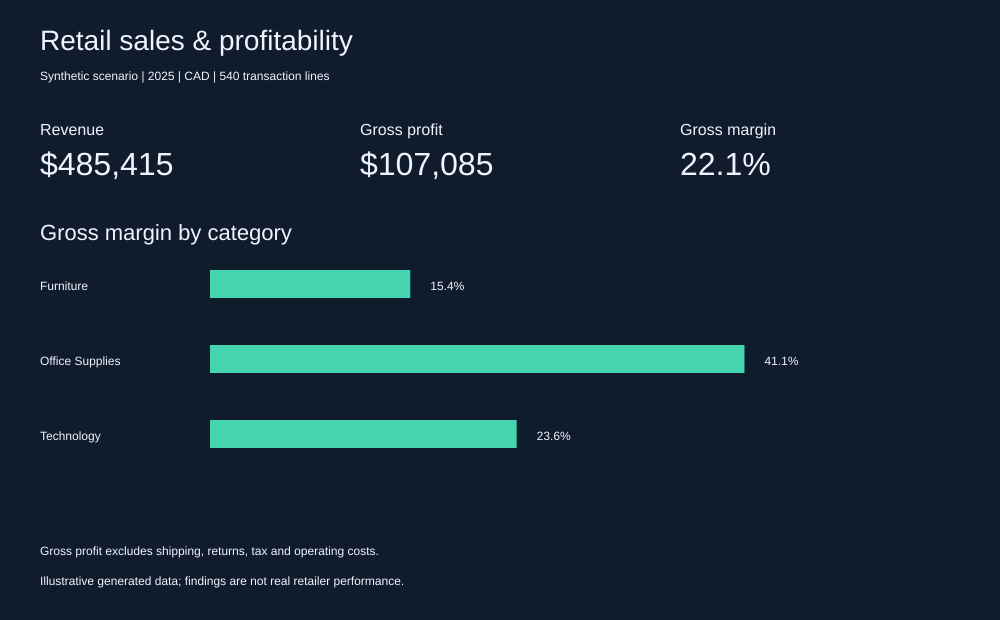

# Retail sales and profitability

Synthetic retail case study · SQL · KPI design · Power BI implementation guide

## Business brief
A fictional retail manager needs to understand category profitability and discount exposure before setting promotion rules. Decisions: which categories deserve margin protection, and which discount bands require review?

## Results
- Revenue: CAD 485,415.00; gross profit: CAD 107,085.00; weighted gross margin: 22.06%.
- Category margins: Furniture: 15.41%, Office Supplies: 41.11%, Technology: 23.59%.
- Discount-band margins: 0% discount: 33.85% margin, 10% discount: 26.19% margin, 20% discount: 16.79% margin, 30% discount: 5.70% margin.



## Recommendations and limits
Review furniture promotions first because its modeled unit cost leaves less room for discounting. Require a projected gross-margin check before deep promotions. Test promotion changes against units sold and total gross profit; do not assume higher margin percentage maximizes profit. Discount relationships are mechanically generated from fixed category prices and costs, not causal evidence of consumer behavior. No real company, customer, or performance claims are made. Gross profit is not net profit.

## Reproduce
Requires Python 3 standard library only. Run `python3 build.py` from this folder. It deterministically regenerates sales.csv, analysis.sql, results.json, dashboard.svg and this README. No external packages or data downloads. The script creates an in-memory SQLite table and executes the SQL queries.

## Data provenance and dictionary
Original synthetic data generated by build.py, seed 28; 12 months × 3 categories × 3 regions × 5 lines = 540. No personal data or external dataset. Currency: CAD; no currency conversion. Each row is a transaction line, not necessarily a distinct customer or order.

|Column|Meaning|
|---|---|
|line_id|Unique integer line key|
|date|ISO date; monthly representative date, not actual daily activity|
|category|Furniture, Technology, Office Supplies|
|region|East, West, Central; fictional segments|
|quantity|Units, integer 1–8|
|discount_pct|Percent off list price: 0, 10, 20, 30|
|sales_cents|Quantity × category price × (1 − discount/100)|
|cogs_cents|Quantity × category unit cost|
|gross_profit_cents|Sales less COGS|

## Validation
Run includes assertions for 540 unique line keys, row-level profit reconciliation and SQL revenue reconciliation to Python totals. Integer cents avoid currency rounding drift. Margin is SUM(profit)/SUM(sales), never an average of row margins. Results are saved in query order in results.json.

## Power BI implementation
No PBIX is included or claimed. Import sales.csv with Get Data → Text/CSV. Set date to Date and monetary columns to Whole number. Create these measures and format as CAD or percent:

```dax
Revenue = DIVIDE(SUM(sales[sales_cents]), 100)
Gross Profit = DIVIDE(SUM(sales[gross_profit_cents]), 100)
Gross Margin = DIVIDE([Gross Profit], [Revenue])
```

Add KPI cards, category margin bars, monthly revenue and gross profit lines, and region/category/discount slicers. Use a date table related one-to-many to sales[date] for time intelligence. Acceptance: unsliced cards match the totals above; selecting a category matches analysis.sql; zero revenue returns blank margin. dashboard.svg is a static verified analysis visual, not a Power BI report export.
