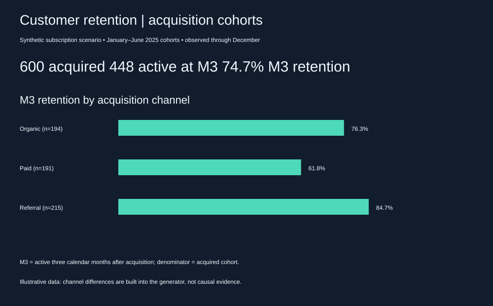

# Customer retention and cohort analysis

A reproducible subscription analytics case study using **original synthetic data**. No real customers, company metrics or external dataset.

## Business question and decision
A fictional subscription team wants to know how retention differs by acquisition channel and when cohorts lose subscribers. Use the analysis to prioritize an onboarding experiment and determine whether acquisition volume is translating into sustained activity.

## Findings
- 600 customers acquired across January–June 2025; 448 still active at month 3: **74.67% M3 retention**.
- Channel M3 retention: Organic: 76.29% (148/194), Paid: 61.78% (118/191), Referral: 84.65% (182/215).
- These differences are deliberately generated using channel-specific dropout probabilities. They are illustrative associations, not estimates of real channel quality or causal effects.



## Recommendations
Investigate Paid onboarding first, then run a randomized onboarding experiment within channel. Measure M3 retention alongside acquisition cost and contribution margin before reallocating budget. This dataset contains neither acquisition costs nor revenue, so ROI and lifetime value cannot be inferred. Experiment success criteria should be agreed before launch; historical channel differences alone do not justify a budget change.

## Method and KPI contract
One row per active customer per calendar month. M0 is acquisition month. M3 retention = distinct customers active at cohort month + 3 divided by distinct acquired customers. All six cohorts have at least three months of follow-up by the 2025-12 observation cutoff. Later-month comparisons must use equally mature cohorts; do not treat unobserved ages as zero retention. Generator models permanent dropout with no reactivation. It is not a churn prediction model. Absence after the last observed month cannot prove a future cancellation.

## Reproduce and validate
Run `python3 build.py` with Python 3 (standard library only). Outputs: activity.csv, analysis.sql, results.json, dashboard.svg and README.md. Seed 2811; 100 customers per cohort; channel-specific monthly dropout probabilities Organic 8%, Paid 14%, Referral 6%. Dropout occurs after that month's activity. Assertions validate unique customer-months, 600 acquisition keys, retention bounds, independent M3 counts and channel denominator reconciliation. SQL runs against an in-memory SQLite database. results.json contains the full cohort table and segment calculations.

Full activity.csv is generated locally by the build command; activity-sample.csv contains the first 30 rows for preview only. Do not calculate portfolio KPIs from the preview.

## Data dictionary
|Field|Meaning|
|---|---|
|customer_id|Synthetic customer key, no personal information|
|cohort_month|First active month, ISO date, first of month|
|channel|Organic, Paid or Referral; fixed per customer|
|active_month|Month in which subscription is active, ISO date|
|month_age|Integer calendar month offset from acquisition, M0 onward|

## Power BI build guide
No PBIX file is included or claimed. Import activity.csv; use Date for both month columns and Whole number for month_age. For this cohort report use cohort_month, channel and month_age slicers; do not apply active_month filters to the acquisition denominator. Create:

```dax
Active Customers = DISTINCTCOUNT(activity[customer_id])
Acquired Customers = CALCULATE(DISTINCTCOUNT(activity[customer_id]), REMOVEFILTERS(activity[month_age]), activity[month_age] = 0)
Cohort Retention = DIVIDE([Active Customers], [Acquired Customers])
```

Format retention as a percentage. Matrix: cohort_month rows, month_age columns, Cohort Retention values with heatmap formatting. Chart: channel vs Cohort Retention filtered to month_age=3. Acceptance checks: M0 is 100% for every cohort; M3 total is 74.67%; channel counts match results.json. Show cohort sizes and observation cutoff prominently. A date table and explicit maturity measures are needed before extending this guide to rolling live cohorts. dashboard.svg is a static analysis visual, not a Power BI export.
