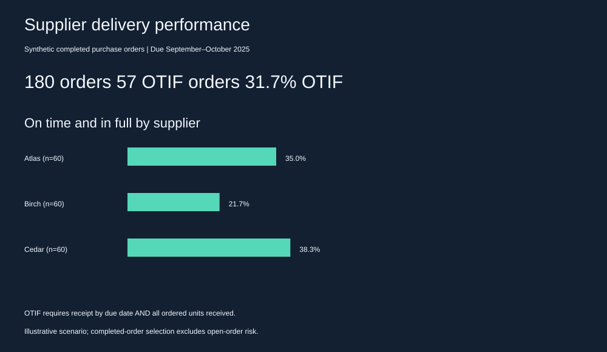

# Supplier delivery performance and supply chain analysis

Original synthetic case study · Python · SQLite · KPI design · Power BI guide

## Business brief
A fictional procurement manager needs to identify suppliers requiring a delivery improvement plan. The analysis separates order-level on-time-in-full (OTIF) from unit-weighted fill rate. The decision is where to investigate delivery reliability before changing sourcing allocations.

## Findings
Across 180 completed purchase orders, **57 met OTIF (31.67%)**.

|Supplier|Orders|OTIF %|Unit fill %|Average days late|
|---|---:|---:|---:|---:|
|Atlas|60|35.00|94.84|0.28|
|Birch|60|21.67|95.51|2.05|
|Cedar|60|38.33|94.39|0.63|



## Recommendations and limitations
Start a delivery root-cause review with Birch, whose modeled delays are more frequent. Review due-date accuracy, transport milestones and shortage reasons before negotiating a corrective-action plan. Monitor OTIF and fill rate together: high unit fill can coexist with poor delivery timing. Supplier delay distributions are deliberately built into this generator; this is not real supplier evidence or proof that any sourcing change will improve service. Cost, quality, lead time, demand, inventory and open orders are absent, so this project does not estimate inventory savings or recommend order quantities.

## KPI contract
- OTIF: completed POs received on or before due date AND received_units = ordered_units, divided by all completed POs. Each order has equal weight.
- Unit fill: SUM(received_units)/SUM(ordered_units); quantity weighted, not average order fill.
- Average days late: mean MAX(0, receipt_date − due_date), including on-time orders as zero. Calendar days, not business days.
- Scope: one final receipt per PO; no split shipments, cancellations, returns or open POs. Due dates span 2025-09-01 to 2025-10-30. Include open overdue POs in a production scorecard to avoid completed-order selection bias.

## Reproduce
Run `python3 build.py` (Python 3 standard library only). It regenerates the full 180-row purchase_orders.csv, analysis.sql, results.json, dashboard.svg and this README. SQL executes in an in-memory SQLite database. Seed 2823; 60 POs per supplier. Ordered units 20–100; shortages sampled from [0,0,0,5,10]. Delays sampled by supplier as defined in build.py. The CSV is original synthetic data with no external licensing dependency or personal information.

## Validation
Assertions check unique PO keys, quantity bounds, row-level OTIF logic, supplier order and OTIF reconciliations, and independently calculated weighted fill rates. All passed on generation. Saved results include query column names. Acceptance examples: an early short delivery fails OTIF; a late complete delivery also fails; an exact-due-date complete delivery passes.

## Data dictionary
|Field|Definition|
|---|---|
|po_id|Unique synthetic purchase order integer|
|supplier|Fictional Atlas, Birch or Cedar|
|ordered_units|Positive integer quantity requested|
|received_units|Final received units; never above ordered quantity|
|due_date|Agreed due date, ISO YYYY-MM-DD|
|receipt_date|Final receipt date, ISO YYYY-MM-DD|
|otif_flag|1 if on time and complete, else 0|

## Power BI implementation
No PBIX is included or claimed. Import purchase_orders.csv. Set due_date and receipt_date to Date; quantities, po_id and otif_flag to Whole number. Use supplier and due-month slicers. Create:

```dax
Orders = COUNTROWS(purchase_orders)
OTIF Orders = SUM(purchase_orders[otif_flag])
OTIF Rate = DIVIDE([OTIF Orders], [Orders])
Unit Fill Rate = DIVIDE(SUM(purchase_orders[received_units]), SUM(purchase_orders[ordered_units]))
```

Format rates as percentages. Cards: Orders, OTIF Orders, OTIF Rate, Unit Fill Rate. Bar chart: supplier versus OTIF Rate; table: supplier, order count, OTIF, fill. A date dimension should relate to due_date for due-period reporting; receipt-date reporting needs a separate relationship definition. Unsliced and supplier-filtered metrics must match results.json. dashboard.svg is a static analysis visual, not a Power BI report export.
